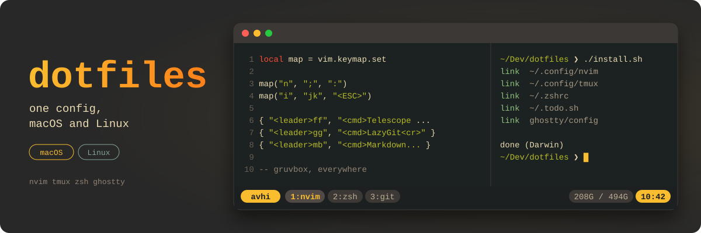
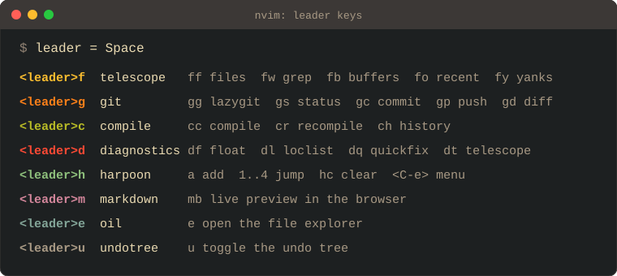
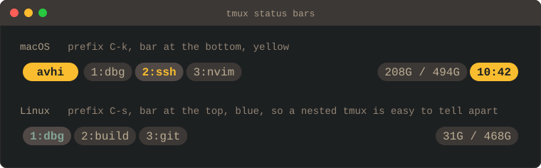

<p align="center">
  
</p>

<p align="center">
  <a href="https://github.com/AvhiMaz/dotfiles/actions/workflows/check.yml"></a>
  
  
  <a href="LICENSE"></a>
</p>

My setup for **macOS** and **Linux**. One config, both machines. The few real
platform differences are handled inside the configs, not by duplicating them.

Every key binding is in [CHEATSHEET.md](CHEATSHEET.md), grouped by plugin.

## How it's built

There is no `mac/` and `linux/` split. Every tool has one directory, and
`install.sh` symlinks it into `$HOME`, so the repo is live: edit a file here
and the change is in effect immediately, no copying or rebuild step.

```
nvim/          neovim, lazy.nvim, single shared config
tmux/          tmux.conf + linux.conf overrides
zsh/           zshrc + darwin.zsh / linux.zsh + todo.sh
ghostty/       terminal config
install.sh     symlinks everything into place
CHEATSHEET.md  every binding, grouped by plugin
.github/       CI: lint, then a fresh install on macOS and Linux
```

Where a machine genuinely needs something different, the shared file branches
on `uname` and pulls in a small per-platform file. That keeps the difference to
a handful of lines instead of two copies of everything that drift apart.

## Getting started

If you want to use this, fork it first. Then you are working against your own
remote, and you can push your changes back instead of carrying a diff forever.

```sh
git clone https://github.com/<you>/dotfiles.git ~/Dev/dotfiles
cd ~/Dev/dotfiles && ./install.sh
```

`install.sh` symlinks into `$HOME` rather than copying, which is the whole
point: your configs and your git checkout are the same files. Edit, and it is
already applied. Commit when you like it.

Anything already in place is moved to `~/.dotfiles-backup/<timestamp>/` first,
so it is safe to run on a machine that already has configs.

Clone it anywhere you want. Nothing hardcodes the path.

The first `nvim` start installs the plugins at the versions pinned in
`nvim/lazy-lock.json`, then the treesitter parsers. On another machine after a
pull, `:Lazy restore` brings it to the same versions.

## Neovim

<p align="center">
  
</p>

Leader is `Space`, and the keys are grouped by what they do: `f` finds
(Telescope), `g` is git, `c` compiles, `d` is diagnostics, `m` is markdown.
LSP comes from nvim-lspconfig with servers installed by mason, and rust goes
through rustaceanvim with the same keys. Copilot gives inline suggestions only,
no panel. The full list, plugin by plugin, is in
[CHEATSHEET.md](CHEATSHEET.md).

`<leader>mb` opens a live preview of a Markdown file in the browser. It updates
as you type and follows the cursor. Locally it opens the default browser on
`localhost:8090`. Over ssh it listens on the remote machine instead and prints
the URL to open on yours; while it runs, anyone on that machine's network can
open the page too.

## Platform differences

<p align="center">
  
</p>

`tmux/tmux.conf` is the base and `tmux/linux.conf` holds the Linux overrides,
sourced last so they win. Config lives in `~/.config/tmux/`, not `~/.tmux.conf`.

|       | prefix | bar                       | clipboard |
| ----- | ------ | ------------------------- | --------- |
| macOS | `C-k`  | bottom, yellow, full      | `pbcopy`  |
| Linux | `C-s`  | top, blue, windows + disk | `xclip`   |

Different prefixes so nesting works: the key tells you which tmux you are
talking to. `C-s` needs flow control off, which `zsh/linux.zsh` handles.

`zsh/zshrc` is shared and sources `zsh/darwin.zsh` or `zsh/linux.zsh` based on
`uname`. Those hold the parts that genuinely differ: homebrew paths and the
android sdk on macOS; solana and bun paths, the UTF-8 locale and `stty -ixon`
on Linux.

Over ssh, nvim switches to OSC 52 so a yank on the remote lands in the local
clipboard. tmux needs `set-clipboard on` for that to pass through, otherwise it
swallows the sequence. The reverse direction does not exist: terminals refuse to
serve clipboard reads to remote programs, so paste from the local machine is
`Cmd-V`, not `p`.

Everything else is identical on both.

## CI

[`check.yml`](.github/workflows/check.yml) runs on every push to `master` and
on pull requests:

- **lint**: shellcheck on `install.sh` and `zsh/todo.sh`, and a syntax check of
  every zsh file.
- **install**, on macOS and Linux: `install.sh` into a fresh home, the tmux
  config loaded into a real server, every plugin installed from the lock file,
  then nvim started and checked for errors and missing mappings.

## Requirements

neovim 0.12+, tmux 3.4+, zsh with oh-my-zsh, starship, zoxide, fzf, bat,
ripgrep, fd, and a Nerd Font. The treesitter parsers need `tree-sitter-cli`
0.26.1+ from your package manager, not npm, and a C compiler.

On Linux `fd` is packaged as `fdfind`, so symlink it:

```sh
mkdir -p ~/.local/bin && ln -sf "$(command -v fdfind)" ~/.local/bin/fd
```

tmux draws `_` instead of icons unless the locale name contains `UTF-8`. It
string-matches the name, so `en_IN` fails even though its charmap is UTF-8.
`zsh/linux.zsh` sets `LANG=en_IN.UTF-8`; for everything outside the shell:

```sh
sudo update-locale LANG=en_IN.UTF-8
```

## License

[MIT](LICENSE)
